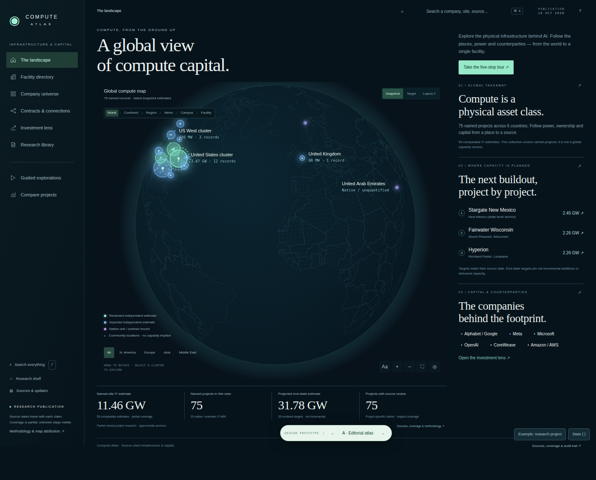
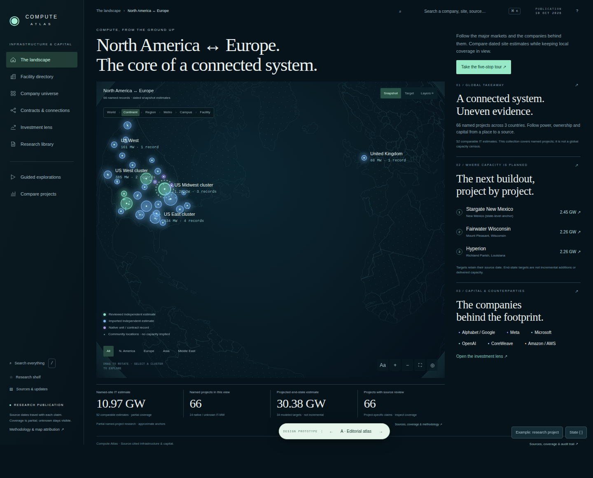
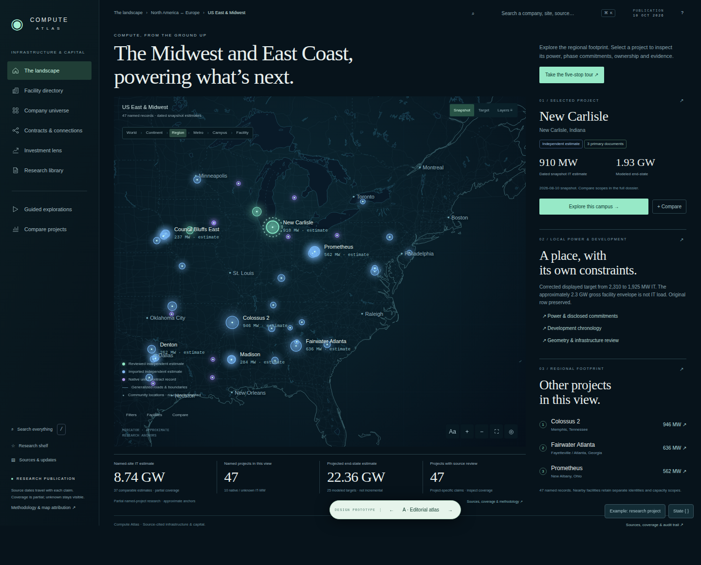
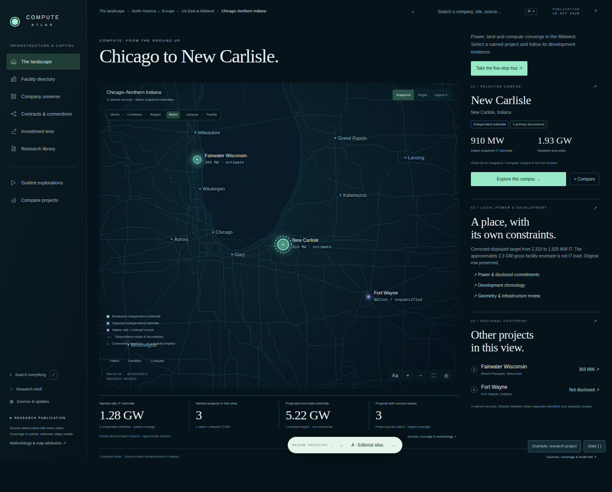
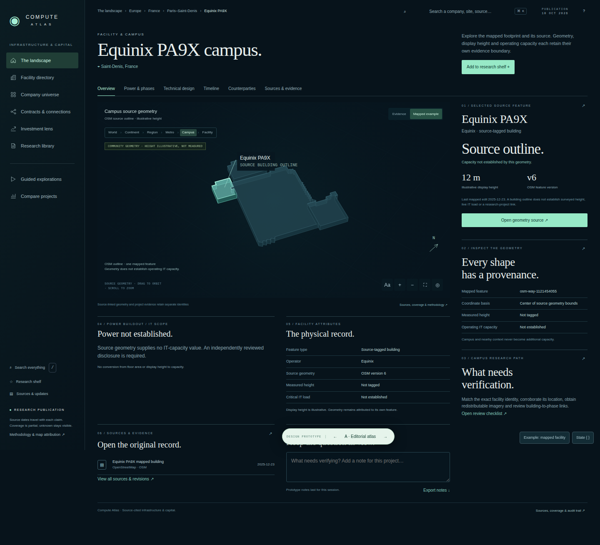
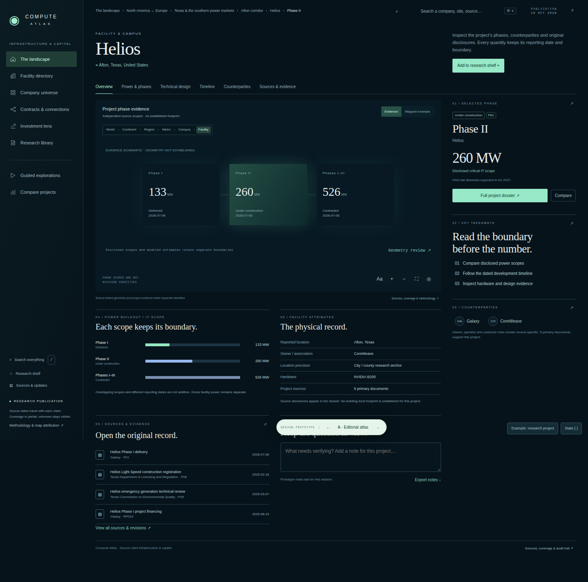
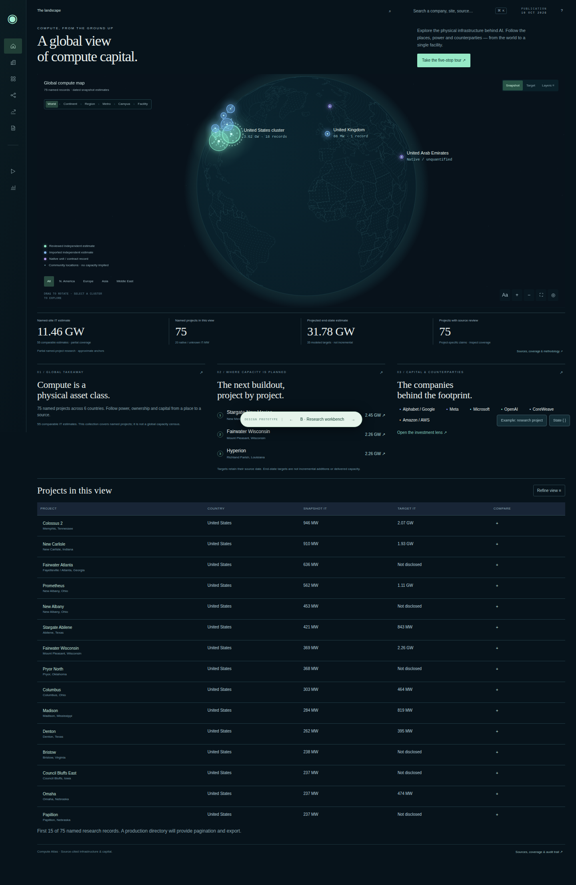
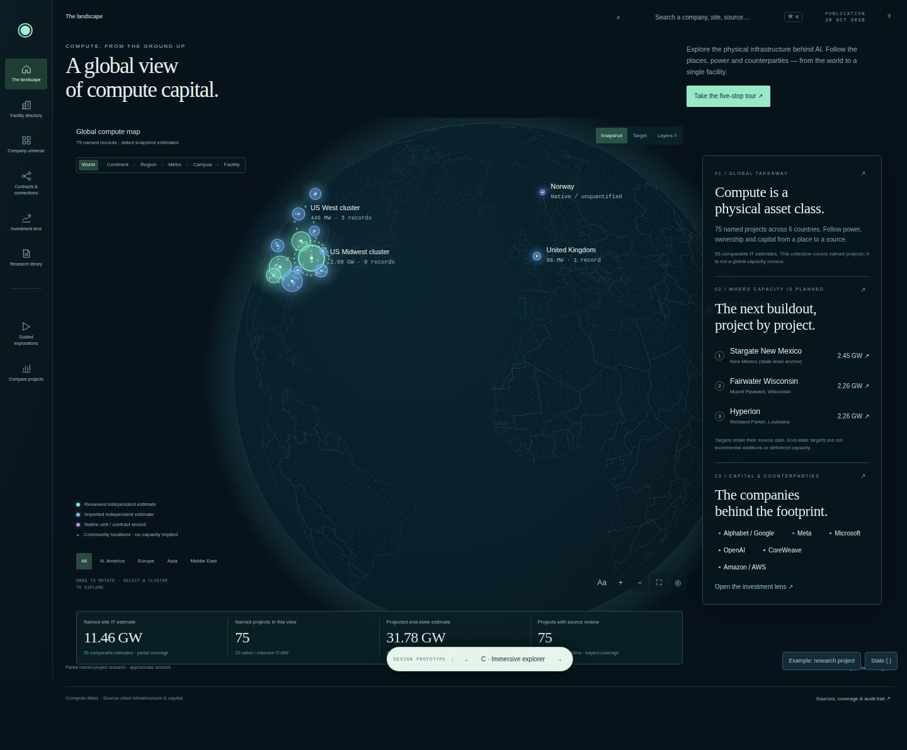
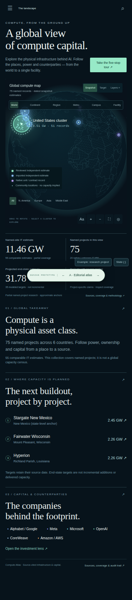
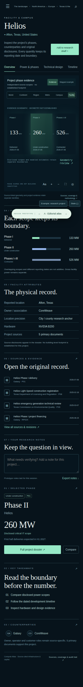

# Atlas design review

Throwaway branch `prototype/atlas-experience-design`. [Complete experience and missing-feature plan](atlas-experience.md). Production is unchanged by these files.

Recommended: A, the editorial atlas. It follows the approved map / analysis rail / metric composition and keeps deeper research in place. B and C answer different research tasks; they are alternatives, not three production themes.

The captures use actual publication records. Equinix PA9X is the mapped source-feature example; Helios is the independently sourced phase-evidence example. They are separate facilities. Sourced campus imagery and building-to-phase matches remain acquisition deliverables.

## A-world

## A-continent

## A-region

## A-metro

## A-campus

## A-facility-evidence

## B-world

## C-world

## A-world-mobile-390

## A-facility-mobile-320

## Review evidence

A serial, resource-capped Chromium session captured all six scales, both alternatives, search, timeline, selected phase, 1366×768 desktop and 390/320-pixel layouts. Nineteen captures, zero uncaught browser errors and zero horizontal overflow in the checked states. The four metrics end at y=757 in the 768-pixel desktop. These are manual design observations, not production acceptance.
