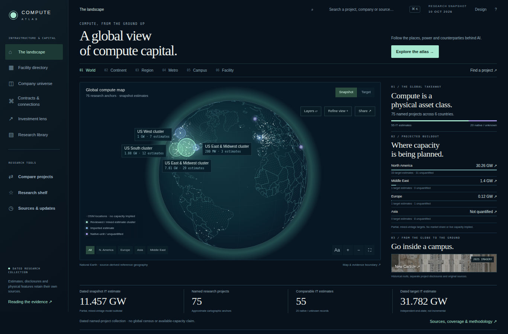
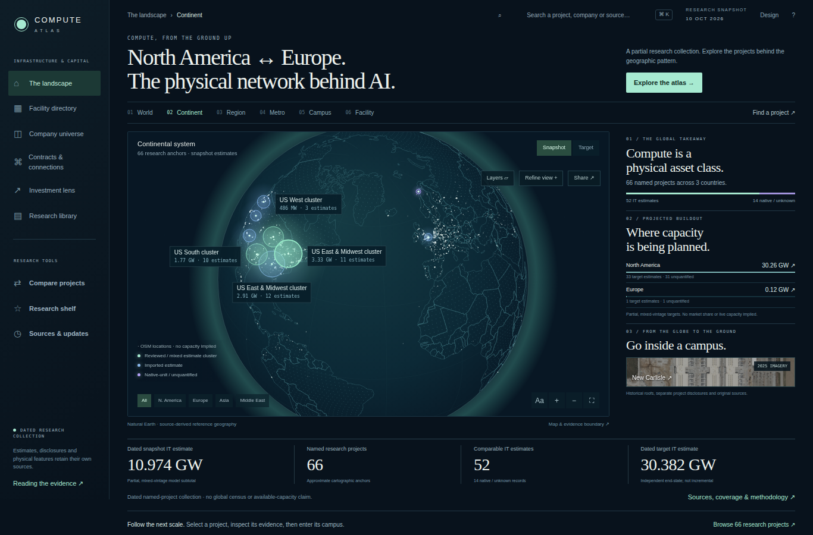
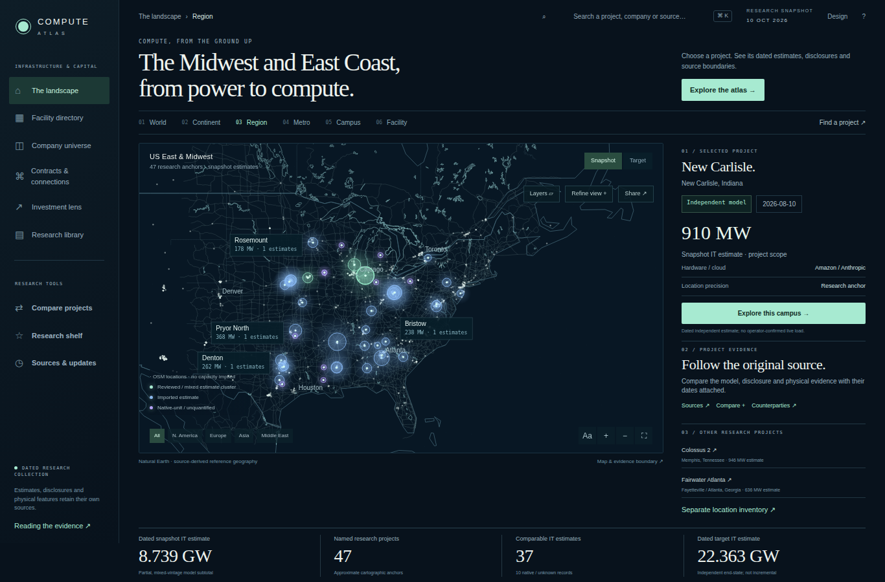
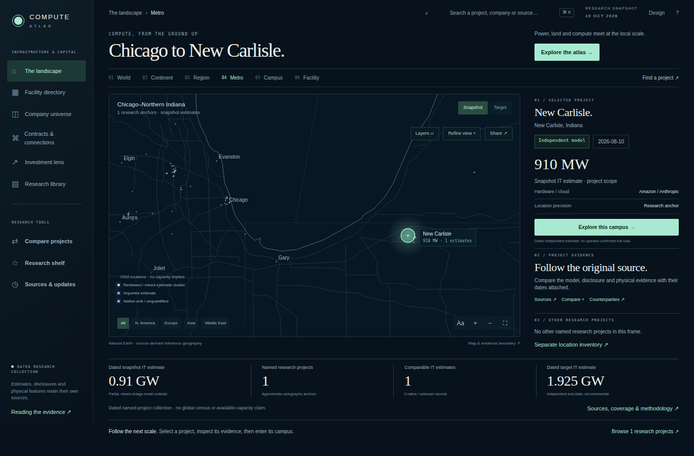
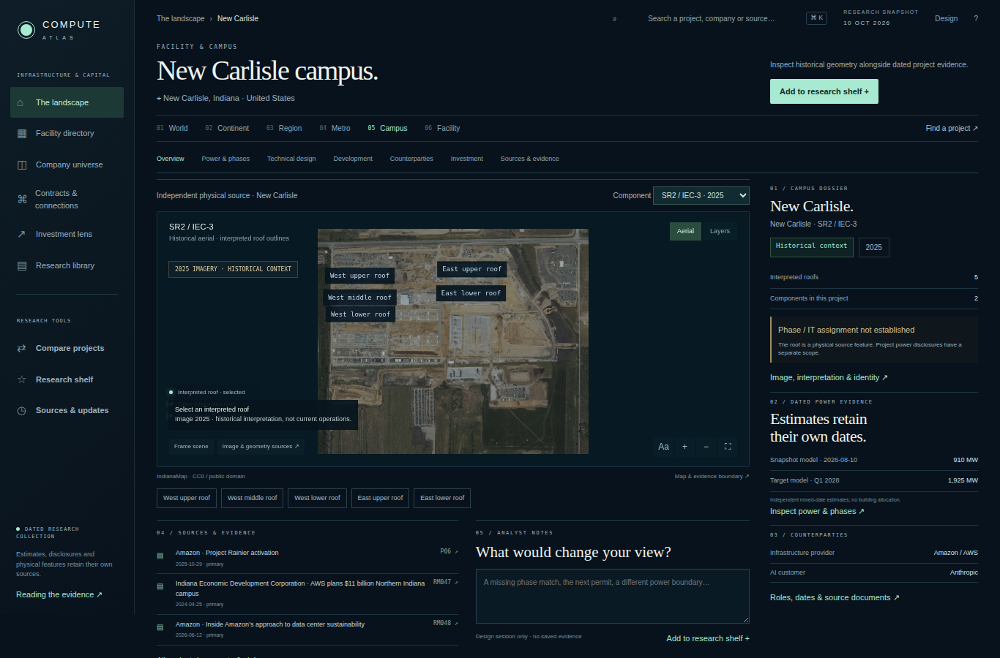
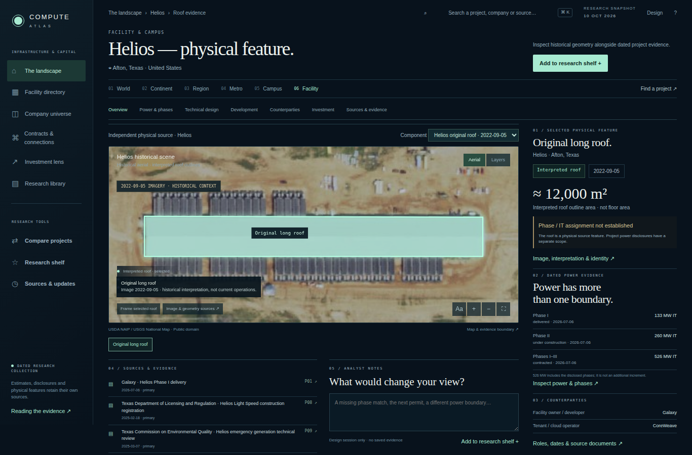
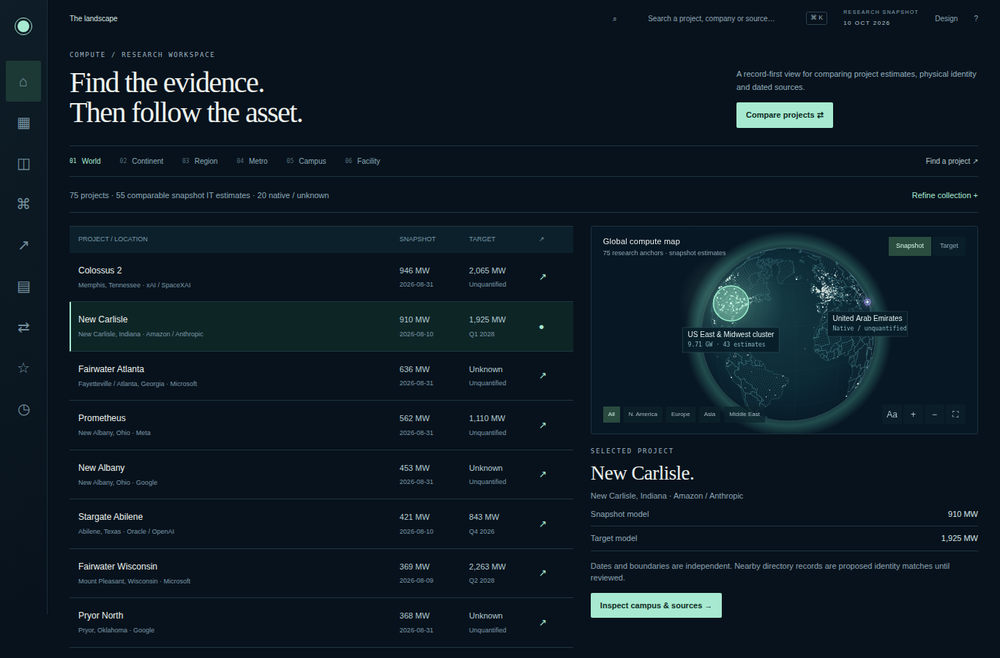
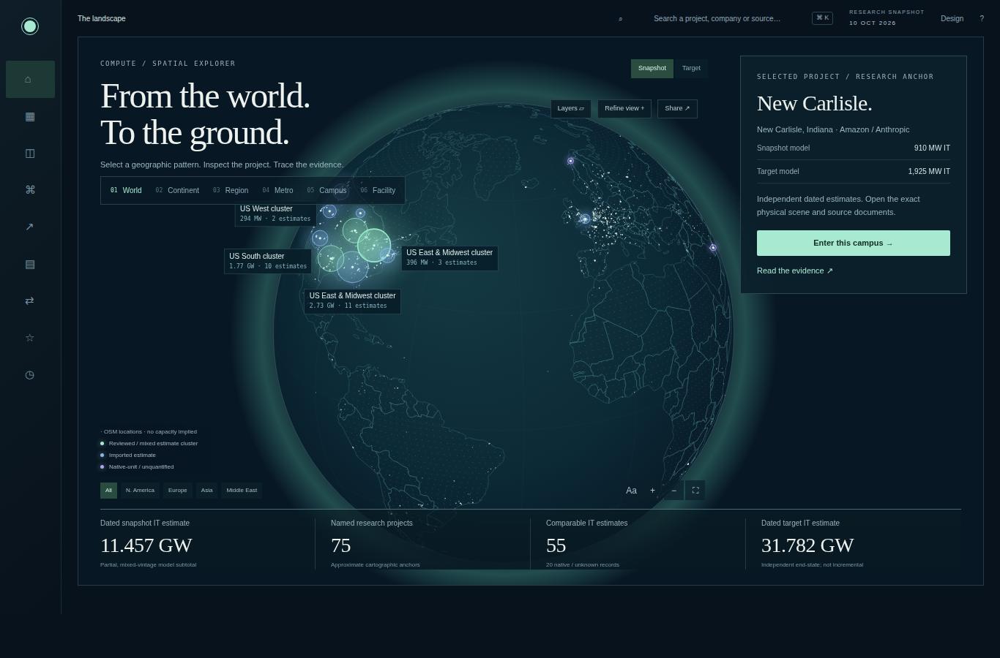
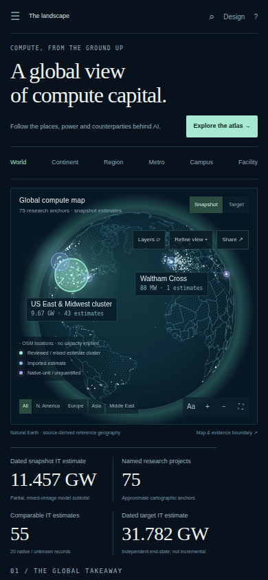
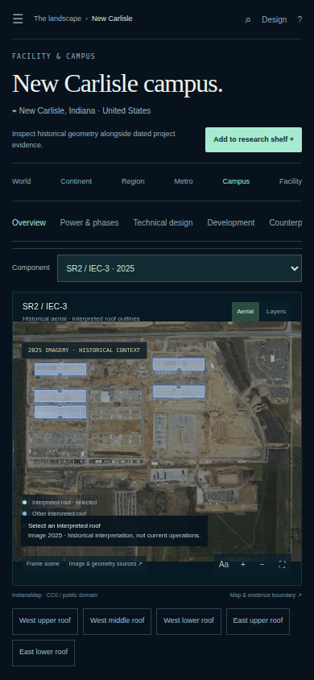

# Compute Atlas — visual design review

**Design study, 12 October 2026. Production is unchanged.** The prototype lives on `prototype/atlas-redesign-review`; it is not an implementation PR for the running app.

[Download the clickable preview](atlas-redesign-review.html). Save the HTML file and open it in a browser; it includes its data, imagery, styles and scripts. Use the A/B/C controls to compare layouts, the six scale buttons to explore the journey, and **Design** in the top bar to hide/show review controls. The screenshots below exclude that review toolbar so the proposed product layout is visible.

## The recommendation: A — Editorial atlas

Keep the visual language of the six original references, but give each scale a different job. World explains the geographic pattern; region and metro inspect a named project; campus and facility inspect physical source features beside dated project evidence. The primary route is **pattern → project → component → roof → source**. Sources, comparison, counterparties and research notes stay reachable from the current context.

The opening screen reserves separate areas for scale navigation, map controls and analysis. Its lower metrics span the map and rail, and the same metrics move immediately below the map on phones. The regional rail compares actual dated target subtotals rather than repeating three large projects. A historical campus preview makes the physical work discoverable on arrival.

### 1. World — discover the pattern

Luminous research clusters sit above a quieter, independent OSM location layer. The analysis rail shows coverage, regional target estimates and an entry to campus evidence. Source-derived land texture and actual source locations replace decorative invented points.

### 2. Continent — inspect the geographic system

North America–Europe framing or an explicitly selected regional scope. Quantities and research coverage recompute for that scope. A selected region is a navigation destination, not merely a camera preset.

### 3. Region — select a project before diving deeper

The selected project rail separates a dated model from reported roles and physical interpretation. The source desk and comparison are direct actions. Nearby OSM locations remain context, not a reconciled facility count.

### 4. Metro — see the local setting

The Chicago–New Carlisle frame includes actual geographic context and independently mapped source locations. Only one named research project lies in this frame; the design does not invent the mockup's additional facilities or connections.

### 5. Campus — choose a component and inspect its evidence

Edison and SR2 are distinct component choices. The hero shows an accepted historical scene and interpreted roofs. Sources and notes sit immediately below it; project models retain their own dates in the rail. A roof is not automatically a numbered building, phase or operating asset.

### 6. Facility — inspect one physical feature

The selected roof has its own image date, interpretation, approximate outline area and source identity. Project-level delivered, construction and contracted IT quantities sit in a separate panel. The missing roof-to-phase assignment occupies a designed, named state.

## Two genuinely different alternatives

**B — Evidence desk.** A narrow icon sidebar; records and comparable dimensions lead. A smaller map and selected-project pane support research and repeated comparison. This is a possible analyst mode, rather than the closest match to the original visual references.

**C — Map focus.** A full-field globe, floating selected-project sheet and lower metric strip. This is a possible expanded discovery mode. It trades some simultaneous analytical reading for spatial immersion.

## Mobile and tablet

The sidebar becomes a menu; the six scales remain visible. On phones, geographic metrics follow the map before the analysis rail. Campus topics scroll horizontally, the component selector fills the available width, and sources remain part of the reading order. Tablet moves the analysis below a useful-width map.

| World on phone | Campus on phone |
| --- | --- |
|  |  |

[Tablet layout](review/A-tablet.png) · [1366×768 opening screen](review/A-short.png).

## Missing features have a place in the design

| Feature | Designed behavior | What the prototype demonstrates |
| --- | --- | --- |
| Regional analysis | Compare partial dated target estimates, quantified records and unknowns; enter the exact scope | Clickable regional rows, URL state and Back |
| Physical navigation | Select project → component → interpreted roof, while preserving the project context | Three real historical scenes, component selector, roof selection and feature inspector |
| Power and phase correspondence | Propose a building/phase match with source locator and date; review before assigning power | Named unmatched state and proposed review workflow; no invented roof capacity |
| Inventory correspondence | Keep research, OSM and operator/publisher directories separate; review typed identity links | Side-by-side identity workflow design; review submission is intentionally unavailable |
| Source desk | Document → locator → claim → accepted revision; compare changed versions before review | Original source drawers, real document links and designed revision state |
| Layers | Expose source, dates, coverage, rights and unavailable states per layer | Research/OSM/label toggles; electricity inspection affordance; current imagery/fiber acquisition states |
| Comparison | Compare matching units and boundaries with dates beside each value | Session comparison of New Carlisle and Helios; no aggregate capacity claim |
| Company and financial context | Separate reported roles, company financials, campus costs, commitments and modelled replacement cost | Actual role/source rows and scoped financial presentation; wider company view remains a requirement |
| Timeline | Distinguish observation, model date and future projection | Dated model chronology and project-topic navigation |
| Research shelf and notes | Save project/feature identity and private notes separately from evidence publication | Session-only notes and shelf; production persistence is not implemented here |
| Recovery | Retain unavailable requested source identity; show what is missing and how to recover | Named image, relationship and assignment availability states; network recovery implementation remains a separate task |

## Review record and implementation boundary

The twelve screenshots were manually inspected at desktop, short desktop, tablet and phone sizes. The study was exercised through regional entry, browser Back, campus entry, roof selection, image/source drawers and comparison. No uncaught page errors or horizontal overflow occurred in the captured views. [Capture notes](review/capture-notes.json) record the view dimensions and observed layout.

The 18 October PR review fixed two prototype defects: navigation from search and
refinement drawers now dismisses the old drawer, and unavailable IT estimates
remain explicitly unquantified in every layout and comparison. The exported HTML
and its hash receipt were regenerated. `python qa/design-review.py` checks those
journeys, regional reload/Back, source-feature inspection, deterministic export,
artifact hashes and 40 views across the three alternatives at 1440, 1366, 1024,
390 and 320 pixels. The backend suite passed all 271 tests; archive integrity and
production standalone regeneration also passed. CI now includes the isolated
design-study regression checks.

This validates a design study, not production functionality or a deployment. The displayed claims come from the existing dated research collection. Historical imagery remains 2022 for Helios and 2025 for New Carlisle. Phase assignments, current imagery, surveyed geometry, heights, wider fiber service and complete facility reconciliation are not fabricated to resemble the references.

Run the read-only study from the repository with `python tools/preview_atlas_design.py`, then open `http://127.0.0.1:8142/compute/?variant=A`. Re-export it after changing the prototype with `python tools/preview_atlas_design.py --export docs/design/atlas-redesign-review.html`. It never calls the production API or writes research data. The proposed production implementation must be written and verified separately after this design is reviewed.
